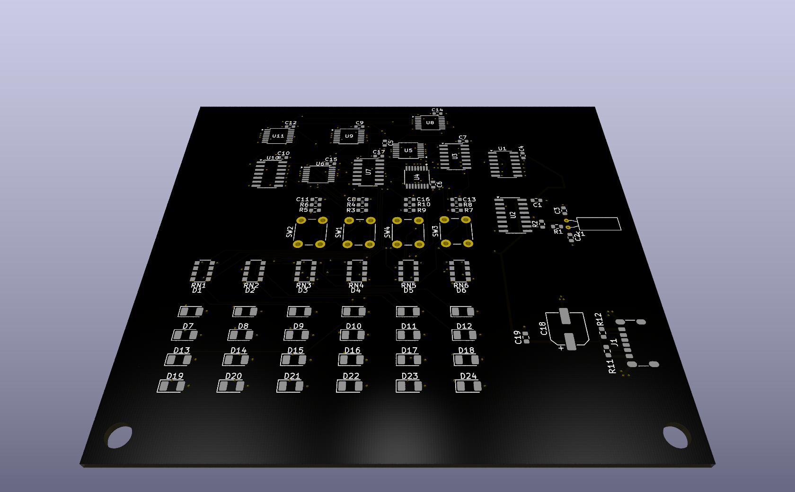

# Binary Clock

## Clock for programers

### Features

- Bulit in tierdnes detector (if you cant read it you need to sleep)
- You can start conversations with it
- You can feel superior if you can read the time from it

### How can you make it?

1. Order the pcb (a stencil is recommended)
2. Order the parts from the bom
3. Print the holder
4. Solder in everything
5. Screw it up with 2 M2 screws
6. Plug the usb-c in
7. Set the time with the buttons
8. You got your Binary clock

### How it works

The crystals Hz is devided down to 1 Hz and it gives the circuit the clock.
There are some binary counter ic. The first one gets the clock straight from the crystal.
The others are geting from an AND gate with 4 input what is watching that the output of the pervius ic is don't flow ower the limit. When all of the inputs are high it send a signal to de next ic's clock pin and the watched ic reset pin.
The counter pins are go straight to the leds trough a resistor.
There are 4 buttons. Those are for setting the time. Those buttons signal goes trough a low pass filter and a pulldown resistor to prevent multipe inputs in a same time. and the signals end at the ic's 
