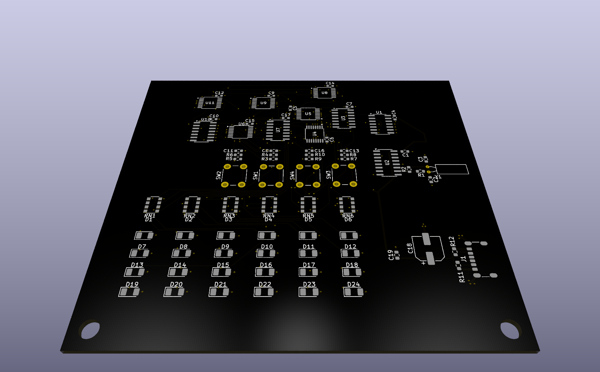
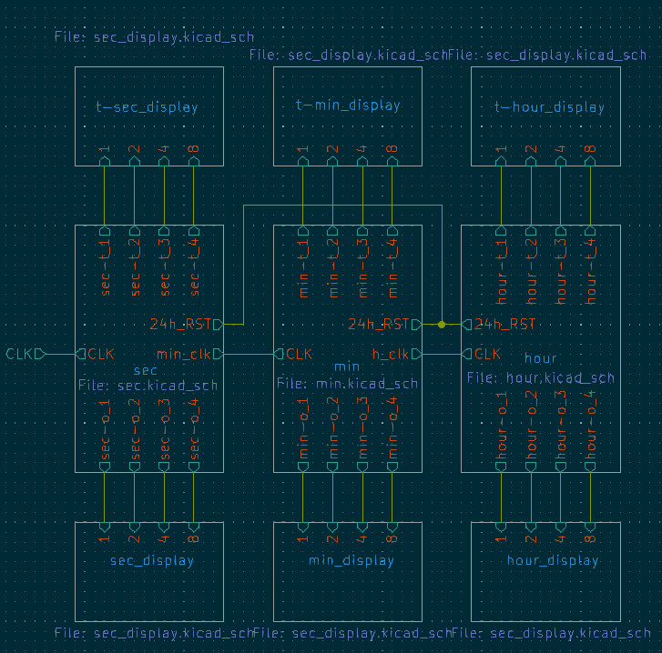
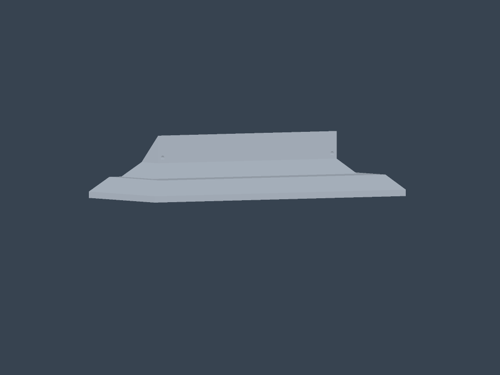

# Binary Clock

## Clock for programers

### Features

- Built in tiredness detector (if you cant read it you need to sleep)
- You can start conversations with it
- You can feel superior if you can read the time from it
- Displays the time in binary

### How can you make it?

1. Order the pcb (a stencil is recommended)
2. Order the parts from the [BOM](#bill-of-materials)
3. Print the holder
4. Solder in everything
5. Screw it up with 2 M2 screws
6. Plug the usb-c in
7. Set the time with the buttons
8. You got your Binary clock

### Bill of Materials

The full BOM with footprints is in [`BOM.csv`](BOM.csv). LCSC prices were checked on 2026-11-01 and converted at 1 USD = 327.9 HUF; PCB, holder and shipping costs are manual estimates.

| Reference | Qty | Value | LCSC | Unit price (USD) | Line total (USD) | Line total (HUF) |
|:--|--:|:--|:--|--:|--:|--:|
| C1, C4–C17, C19 | 16 | 100nF | [C1591](https://www.lcsc.com/product-detail/C1591.html) | $0.0075 | $0.12 | 39.35 Ft |
| C2, C3 | 2 | 22 pF | [C326840](https://www.lcsc.com/product-detail/C326840.html) | $0.0149 | $0.0298 | 9.77 Ft |
| C18 | 1 | 100uF 35V | [C72478](https://www.lcsc.com/product-detail/C72478.html) | $0.0338 | $0.0338 | 11.08 Ft |
| D1–D24 | 24 | Green LED | [C375482](https://www.lcsc.com/product-detail/C375482.html) | $0.0261 | $0.6264 | 205.40 Ft |
| J1 | 1 | USB-C receptacle 6P | [C18357552](https://www.lcsc.com/product-detail/C18357552.html) | $0.0467 | $0.0467 | 15.31 Ft |
| R1 | 1 | 330k | [C2907027](https://www.lcsc.com/product-detail/C2907027.html) | $0.002 | $0.002 | 0.66 Ft |
| R2 | 1 | 10M | [C2930145](https://www.lcsc.com/product-detail/C2930145.html) | $0.0024 | $0.0024 | 0.79 Ft |
| R3, R5, R7, R9 | 4 | 100k | [C14675](https://www.lcsc.com/product-detail/C14675.html) | $0.0022 | $0.0088 | 2.89 Ft |
| R4, R6, R8, R10 | 4 | 10k | [C98220](https://www.lcsc.com/product-detail/C98220.html) | $0.0027 | $0.0108 | 3.54 Ft |
| R11, R12 | 2 | 5.1k | [C2907044](https://www.lcsc.com/product-detail/C2907044.html) | $0.0018 | $0.0036 | 1.18 Ft |
| RN1–RN6 | 6 | 330Ω | [C12018](https://www.lcsc.com/product-detail/C12018.html) | $0.0214 | $0.1284 | 42.10 Ft |
| SW1–SW4 | 4 | SW_Push 6x6x5.5mm | [C42416244](https://www.lcsc.com/product-detail/C42416244.html) | $0.0203 | $0.0812 | 26.63 Ft |
| U1 | 1 | 4013 | [C13527](https://www.lcsc.com/product-detail/C13527.html) | $0.2526 | $0.2526 | 82.83 Ft |
| U2 | 1 | 4060 | [C134017](https://www.lcsc.com/product-detail/C134017.html) | $0.4094 | $0.4094 | 134.24 Ft |
| U3, U10 | 2 | 4081 | [C40551](https://www.lcsc.com/product-detail/C40551.html) | $0.3278 | $0.6556 | 214.97 Ft |
| U4–U6, U8–U9, U11 | 6 | 4510 | [C2862976](https://www.lcsc.com/product-detail/C2862976.html) | $0.8473 | $5.0838 | 1,666.98 Ft |
| U7 | 1 | 4071 | [C97039](https://www.lcsc.com/product-detail/C97039.html) | $0.4982 | $0.4982 | 163.36 Ft |
| Y1 | 1 | 32.768 kHz | [C3034396](https://www.lcsc.com/product-detail/C3034396.html) | $0.0972 | $0.0972 | 31.87 Ft |
| PCB | 1 | 2 layer | - | $11.22 | $11.22 | 3,679.00 Ft |
| 3D printing filament used| 1 | 35 g | - | $1.00 | $1.00 | 330.00 Ft |
| screw | 2 | M2 - 6mm | - | $0.16 | $0.33 | 100 Ft |
| Shipping | 1 | - | - | $10.00 | $10.00 | 3,000.00 Ft |
| **Total (one clock)** | | | | | **$30.31** | **9,661.95 Ft** |
| **Total (LCSC minimum order)** | | | | | **$37.22** | **11,926.29 Ft** |

The minimum-order total is higher because LCSC sells some parts in larger minimum quantities (for example 100 pcs of the 0603 resistors) even though only a few are needed per board.

I 3d printed the washer for it because its better than a metal one for the pcb.

### How it works

The crystals Hz is divided down to 1 Hz and it gives the circuit the clock.
T
here are some binary counter ic. The first one gets the clock straight from the crystal.

The others are getting from an AND gate with 4 input what is watching that the output of the pervious ic is don't flow over the limit. When all of the inputs are high it send a signal to de next ic's clock pin and the watched ic reset pin.
The counter pins are go straight to the leds trough a resistor.

There are 4 buttons. Those are for setting the time. Those buttons signal goes trough a low pass filter and a pulldown resistor to prevent multiple inputs in a same time. and the signals end at the ic's clock pin.

It's just a stand for the pcb

### License

This project is licensed under the MIT License - see the LICENSE file for details.